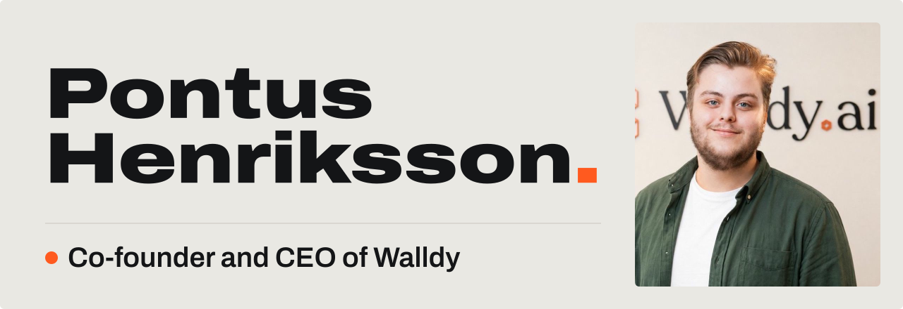

<a href="https://pontushenriksson.com">
  <picture>
    <source media="(prefers-color-scheme: dark)" srcset="./assets/header-dark.svg">
    
  </picture>
</a>

  <a href="https://pontushenriksson.com"><b>pontushenriksson.com</b></a>&nbsp;&nbsp;·&nbsp;
  <a href="https://walldy.ai">walldy.ai</a>&nbsp;&nbsp;·&nbsp;
  <a href="https://pontushenriksson.com/articles">Writing</a>&nbsp;&nbsp;·&nbsp;
  <a href="https://www.linkedin.com/in/pontushenriksson/">LinkedIn</a>&nbsp;&nbsp;·&nbsp;
  <a href="https://www.instagram.com/pontushenrikssn/">Instagram</a>&nbsp;&nbsp;·&nbsp;
  <a href="https://www.tiktok.com/@pontushenriksson">TikTok</a>&nbsp;&nbsp;·&nbsp;
  <a href="https://www.youtube.com/@pontushenrikssn">YouTube</a>&nbsp;&nbsp;·&nbsp;
  <a href="mailto:pontus@henriksson.space">Email</a>

 

### I have been building things since I was ten.

Today I run [Walldy](https://walldy.ai), an AI company in Sundsvall, Sweden, together with Iggy Lundmark. We build AI agents, automations, systems and websites for Swedish companies, and our own products on top of that. I lead the company and own the tech.

The goal is simple: AI that removes real work from real people, without anyone needing to understand how it works.

On the side I still test games for studios like Netflix, Bungie and Microsoft, the same QA work I have done since 2021.

### What we build at Walldy

| Product | What it does |
| :--- | :--- |
| [**Wavedrive**](https://wavedrive.se) | A Swedish CRM with pipeline, calls, email, SMS, quotes with e-signing and dashboards in one workspace. |
| [**Telefonista**](https://www.telefonista.nu) | AI voice agents that answer the phone for Swedish businesses. |
| [**Swereg**](https://swereg.se) | Addresses, industries, company numbers and contact details for every company in Sweden. |
| [**WallNode**](https://wallnode.se) | Websites kept running, secure and backed up on servers in Stockholm. |
| [**StudyPal**](https://studypal.app) | An AI study platform for Swedish students with AI tutors, smart notes and flashcards. |

### What I build with

  
  
  
  
  
  
  
  
  
  
  
  

### Right now

- **Running Walldy.** Full time since September 2026, with Iggy Lundmark.
- **Testing games.** Still doing QA on the side, from Monument Valley 3 to Test Drive Unlimited Solar Crown.
- **Making videos.** Short animated videos about building with AI, on [Instagram](https://www.instagram.com/pontushenrikssn/) first.
- **Off screen.** Running, lifting and disc golf in Sundsvall.

Updated October 2026. The full version lives on my [now page](https://pontushenriksson.com/now).

### A few more things

- Built my first game in Unity at ten and my first full website at fourteen.
- Organised a 24 hour n8n hackathon in Sundsvall in February 2026.
- Selected for the Nexer Future Leader Program.
- Released the lo-fi album *Moss & Mist* in June 2026.

 

<picture>
  <source media="(prefers-color-scheme: dark)" srcset="https://raw.githubusercontent.com/pontushenriksson/pontushenriksson/output/snake-dark.svg">
  
</picture>

73 de SH3DBF

